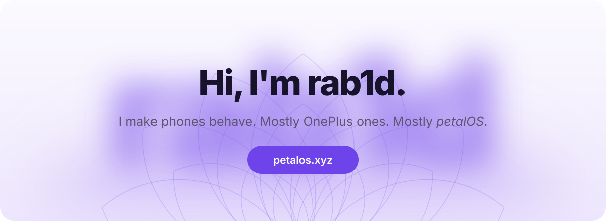

  <a href="https://petalos.xyz">
    <picture>
      <source media="(prefers-color-scheme: dark)" srcset="assets/header-dark.svg">
      
    </picture>
  </a>

I'm a doctor (MBBS, the real kind with a stethoscope), and I spend most of my free time building Android ROMs. My friends think it's an odd hobby. My phone thinks it's a lifestyle.

These days that mostly means **petalOS**, a calm, quick Android 16 ROM that I build from source. I do the boring-but-important bits myself: device trees, kernels, camera HALs, recovery, OTAs. Then I mess with SystemUI until it looks right.

## 🌸 petalOS: your phone, the way it should have shipped

- **Google is up to you.** Sandboxed Play services, microG, or nothing at all, and you can switch later.
- **CATBACK.** My own Android Auto client. It talks to the car directly, so you don't need Google installed.
- **The Island.** Two pieces of actual glass on either side of the punch-hole. Not a black pill. I have opinions about black pills.
- **Apps sleep when the screen does.** Battery life, without killing your notifications.
- **Petal Music.** A music player with AutoMix crossfades. It's heading to F-Droid soon 👀
- On-device assistant, depth wallpapers, a system-wide ad blocker and per-app internet toggles. [The rest is on the site →](https://petalos.xyz)

## 📱 Supported phones

| Phone | Codename | |
|---|---|---|
| OnePlus 15 | `infiniti` | |
| OnePlus 15R | `macan` | |
| OnePlus 15T | `fairlady` | |
| OnePlus Ace 6T | `macanc` | my daily driver |

Builds, checksums and changelogs are all at **[petalos.xyz](https://petalos.xyz)**. Updates come through the built-in updater.

## 🛠️ Built in the open

Apps, device trees and the build system are all public at **[@petalFTW](https://github.com/petalFTW)**. Pull requests are welcome. Bug reports with logs are *very* welcome. Bug reports that just say "doesn't work" get read, sighed at, and then fixed anyway.

-6E43EA?style=flat-square&logo=android&logoColor=white)

## 👋 Say hi

New builds land in the **[Telegram releases channel](https://t.me/rab1ds)** first. Drop by, grab a build, and tell me what broke.

  <picture>
    <source media="(prefers-color-scheme: dark)" srcset="assets/footer-dark.svg">
    
  </picture>

Flashing a custom ROM can void your warranty and erase your data. I'm a doctor, but not that kind, so back up first.

